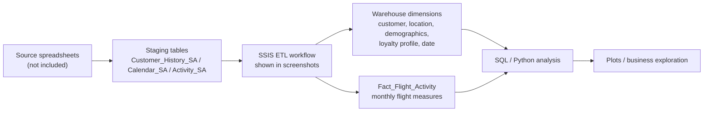

# Airline Loyalty Program — Data Warehouse & ETL
**SQL Server · SSIS workflow design · Dimensional modeling · Python analytics**

An academic data-warehousing project focused on organizing airline customer loyalty and flight activity data for business analysis. The repository includes **SQL Server staging and warehouse DDL**, Python/SQL analytical queries, a presentation, and screenshots of an SSIS-style ETL workflow.

> **Evidence scope:** The repository contains SQL scripts, analysis code, screenshots, and a presentation. It does **not** currently include the original Excel input files, an executable SSIS package (`.dtsx`), a packaged SQL Server database, or a reproducible end-to-end ETL run. The screenshots illustrate project work but do not prove that an SSIS pipeline can be rebuilt from this repository alone.

## Data flow



The diagram describes the documented project workflow; the actual SSIS package files are not available in this repo.

## Relational model

[View the SQL schema](database_setup.sql). The warehouse is centered on `Fact_Flight_Activity`, which references customer and month-level date dimensions. `Dim_Customer` references normalized profile, demographic and location tables: a **snowflake-style** model.


| Table | Role |
| --- | --- |
| `Dim_Location` | Customer geography |
| `Dim_Demographics` | Demographic attributes |
| `Dim_Loyalty_Profile` | Loyalty tier and enrollment type |
| `Dim_Date` | Month/quarter/year reference |
| `Dim_Customer` | Customer reference and dimension relationships |
| `Fact_Flight_Activity` | Flight activity, distances, points earned/redeemed |

[Staging-table schema](Airline-Loyalty+Program_SA.sql) defines `Customer_History_SA`, `Calendar_SA`, and `Activity_SA`.

## ETL documentation

**Control flow** — recorded workflow illustration:


**Customer dimension data flow** — recorded transformation illustration:


These are existing project images. Rebuilding the ETL would require the missing source spreadsheets, SSIS project files, connection managers, transformations, and execution settings.

## Analytical questions

The script [`analysis_queries.py`](analysis_queries.py) issues SQL queries and generates plots to explore:

1. Monthly customer enrollment, including a highlighted 2018 promotional period.
2. Demographic profiles of members enrolling during the campaign.
3. Summer flight activity comparison for 2017 and 2018.
4. Flight activity by province.
5. Average loyalty points accumulated by card type.

**Existing figures:**


[View the existing province-flight visualization](top%2010%20des%20Provinces%20par%20volume%20de%20vols.png).

These are historical visual artifacts; exact numerical claims (for example, segment revenue shares) have **not** been independently reproduced from included data and are intentionally omitted.

## Files

| Path | Content |
| --- | --- |
| [`Airline-Loyalty+Program_SA.sql`](Airline-Loyalty+Program_SA.sql) | Staging schema |
| [`database_setup.sql`](database_setup.sql) | Warehouse DDL |
| [`analysis_queries.py`](analysis_queries.py) | SQL/Python exploratory analysis |
| [`etl_control_flow.png`](etl_control_flow.png) | Existing control-flow screenshot |
| [`etl_data_flow_dimcustomer.png`](etl_data_flow_dimcustomer.png) | Existing transformation screenshot |
| [`Flying-Airplane (1).pptx`](Flying-Airplane%20%281%29.pptx) | Academic project presentation |

## Reproduction notes

Requires **Microsoft SQL Server**, an appropriate **ODBC Driver for SQL Server**, and (for rebuilding the ETL) **SSIS** and the original input data.

1. Review and create staging tables with `Airline-Loyalty+Program_SA.sql` in your own **development database**.
2. Review and create warehouse tables with `database_setup.sql` in dependency order.
3. Rebuild/execute the missing ETL transformations from the source spreadsheets (not supplied).
4. Install Python dependencies: `pandas`, `matplotlib`, `seaborn`, `SQLAlchemy`, `pyodbc`.
5. Update the **local** `server`, `database`, and ODBC driver settings in `analysis_queries.py` before running it.

```bash
python -m pip install pandas matplotlib seaborn sqlalchemy pyodbc
python analysis_queries.py
```

The Python command requires a **populated** warehouse and working Windows/ODBC authentication; it is not an out-of-the-box demo. No complete ETL or analytics test run was performed as part of this documentation update.

## Design decisions and known issues

- **Snowflake-style dimensions:** reduce redundant customer attributes but add joins to reporting queries.
- **Monthly date grain:** supports month-based activity reporting; finer-grain analysis would need a different date model.
- **Staging before transformation:** separates imported spreadsheet types from normalized warehouse attributes.
- **Data typing:** the original DDL uses `FLOAT` for loyalty IDs and monetary measures; production schema design should prefer explicit integer/string business keys and decimal monetary types.
- **Query validation:** the province analysis uses a `DISTINCT` subset that may collapse legitimate activity rows; validate grain and deduplication logic before relying on totals.
- **Reproducibility:** missing SSIS packages/source files limit independent execution. Screenshots and design notes are not substitutes for runnable ETL.

**Possible next steps:** add permitted synthetic data, export sanitized ETL packages, create integrity checks, and document measures without inventing results.

## Project context

Academic data-warehousing and business-analysis exercise. The work demonstrates a warehouse design and an ETL/analytics workflow, **not a production airline system**.
