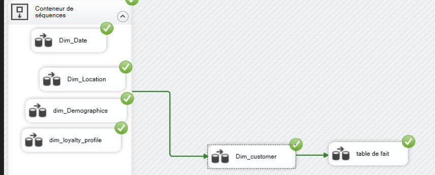
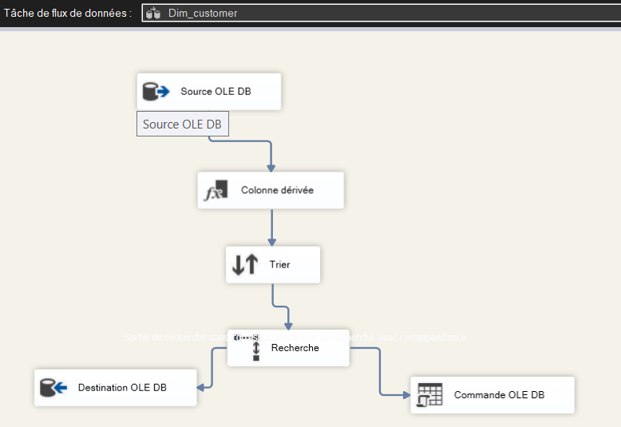

# Airline Loyalty — Data Warehouse & Customer Analytics

**SQL Server · SSIS · Dimensional Modeling · ETL · Python · Business Intelligence**

An academic data-engineering and analytics project built around an airline loyalty program. The goal was to transform customer and flight activity records into a **queryable data warehouse**, then use SQL and Python to explore enrollment trends, loyalty-card behavior and flight activity.

**Engineering focus:** source-to-warehouse modeling, a staged ETL design, relational integrity, dimension/fact separation and translating business questions into analytical queries.

> **Evidence scope:** The repository includes SQL schemas, an analytics script, a project presentation and authentic saved ETL/warehouse illustrations. The original source workbooks, runnable SSIS `.dtsx` packages and populated database are **not committed**. It is a documented academic solution, **not** a reproducible one-command ETL or deployed BI product.

## From source records to analytical insights


The diagram describes the academic workflow documented in this repository. **The SSIS project itself is not available for execution.**

## Data warehouse design

A **snowflake-style dimensional model** separates customer, geographic, demographic, loyalty and time attributes from flight-activity measures.


| Warehouse table | Grain / responsibility | Important data |
| --- | --- | --- |
| `Dim_Customer` | One modeled customer record | Business loyalty number, enrollment/cancellation dates, links to profile dimensions |
| `Dim_Location` | Reusable location descriptors | City, province, country, postal code |
| `Dim_Demographics` | Reusable demographic descriptors | Gender, education, marital status |
| `Dim_Loyalty_Profile` | Loyalty classification | Card category, enrollment type |
| `Dim_Date` | Month-level calendar reference | Month, quarter and year starts |
| `Fact_Flight_Activity` | Customer-period flight activity as intended | Flights, distances, accumulated/redeemed points, redemption value |

The model uses **surrogate primary keys** and foreign keys from customer and fact records to their dimensions. The SQL DDL is available in [`database_setup.sql`](database_setup.sql).

**Modeling trade-off:** normalization avoids repeating demographic and location labels for every fact row, but reporting requires more joins than a flattened star schema. The fact-grain uniqueness rule is **not enforced by a composite unique constraint** in the current SQL DDL, so duplicates and periodicity must be validated before interpreting totals.

## ETL workflow evidence

The source records are first represented by staging tables. The staging layer follows the observed Excel/SSIS input types, while the warehouse organizes customers and monthly activities into related analytical tables.

### SSIS control flow



### Customer dimension data flow



**What these images show:** the flow and transformation design captured during the academic project. **What they do not establish:** a packaged and independently runnable ETL, because the source workbooks, SSIS package definitions, runtime connection managers and execution logs are not provided.

[Review staging definitions](Airline-Loyalty+Program_SA.sql) · [Review warehouse DDL](database_setup.sql) · [Academic project presentation](Flying-Airplane%20%281%29.pptx)

## Business questions explored

The repository includes five SQL-backed investigations in [`analysis_queries.py`](analysis_queries.py).

| Question | Relevant warehouse components | Analytical approach |
| --- | --- | --- |
| How did new enrollments evolve? | `Dim_Customer` | Monthly counts; highlight a February–April 2018 campaign period |
| Who enrolled during the campaign? | Customer + demographics | Segment new enrollments by gender and education |
| How did summer flight activity compare? | Flight fact + date | Compare June–August flight totals for 2017 and 2018 |
| Which provinces have higher recorded flight volume? | Flight fact + customer + location | Aggregate flights by province |
| How do accumulated loyalty points vary by card type? | Flight fact + customer + loyalty profile | Compare average accumulated points across card categories |

### Existing analytical visualizations

**Monthly loyalty enrollments — historical project chart**


**Flight volume by province — historical project chart**


These plots are **committed project artifacts**, not results newly regenerated during this documentation review. Highlighting a promotional period illustrates a **time association**, not proof that the campaign caused the enrollment changes.

## Technology and project artifacts

| Technology | Role in the project |
| --- | --- |
| **Microsoft SQL Server / T-SQL** | Source staging, dimensional tables, joins and aggregations |
| **SSIS** | Designed ETL control/data flows illustrated in the committed screenshots |
| **Python + SQLAlchemy + pyodbc** | Connect to the warehouse and execute T-SQL |
| **Pandas** | Materialize SQL query results for analysis |
| **Matplotlib + Seaborn** | Produce business-facing charts |

```text
Airline-Loyalty+Program_SA.sql       Staging table DDL
database_setup.sql                  Snowflake warehouse table DDL
analysis_queries.py                 SQL analysis and plotting code
etl_control_flow.png                Existing SSIS control-flow capture
etl_data_flow_dimcustomer.png       Existing SSIS transformation capture
shema en flacon  de neige.png       Existing warehouse schema illustration
*.png                               Historical analytical visualizations
Flying-Airplane (1).pptx             Academic project presentation
```

## How to inspect or reproduce the available parts

**Prerequisites:** Microsoft SQL Server, an ODBC Driver for SQL Server, Python and the original source data/SSIS definitions if a complete ETL rebuild is intended.

1. Create an isolated **development database**, then review and execute [staging DDL](Airline-Loyalty+Program_SA.sql).
2. Review and execute [warehouse DDL](database_setup.sql), creating referenced dimensions before `Dim_Customer` and `Fact_Flight_Activity`.
3. Use a compatible ETL solution and source workbooks to populate the staging/warehouse tables. **These inputs are not in the repository.**
4. Review the local connection configuration in [`analysis_queries.py`](analysis_queries.py): it currently targets SQL Server on `LOCALHOST`, database `DW_Flights` and **ODBC Driver 17 for SQL Server** with Windows integrated authentication.
5. Once a compatible and **populated** database is available, install dependencies and execute the analysis script:

```bash
python -m pip install pandas matplotlib seaborn sqlalchemy pyodbc
python analysis_queries.py
```

This is a **conditional reproduction recipe**, not a guaranteed runnable demo. The Python script uses `plt.show()`, so charts are displayed interactively rather than automatically written to PNG. A SQL Server instance, valid driver/authentication and source data are necessary.

## Data-quality and methodological considerations

- **Business IDs should not be floating-point keys.** The staging and warehouse SQL currently use `FLOAT` for loyalty numbers; integer or character keys would be safer for identity and joins.
- **Financial values require explicit precision.** `Salary`, `CLV` and some numeric measures use `FLOAT`; a production schema would ordinarily use suitable `DECIMAL` types where exactness matters.
- **Deduplication needs a declared grain.** The province query applies `DISTINCT` to only customer and flight-count fields, which could collapse legitimate monthly activity rows. The loyalty-points analysis also deduplicates a subset of fact fields; both require grain-aware verification.
- **Time-series comparison is descriptive.** Enrollment/flight changes and loyalty behavior may be influenced by seasonality, population changes or other causes. No causal attribution or forecasting accuracy is claimed.
- **ETL validation is not reproducible here.** Missing SSIS source packages and workbooks prevent independent end-to-end execution.
- **Operational checks are a next step.** Add source-to-target row-count checks, rejected-record logging, surrogate-key lookup audits and uniqueness/referential-integrity tests before treating the pipeline as production-ready.

## What this project demonstrates

The most important experience is **turning raw operational records into a modeled analytical system**: identifying grains and measures, separating facts from dimensions, planning transformations, joining data across business entities and answering questions from an organized warehouse.

**Project type:** academic data-engineering and business-analysis work. The repository documents the team exercise and its artifacts; individual contributions are not independently itemized here.
